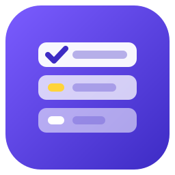

<p align="center">
  
</p>

<h1 align="center">YandexTracker for .NET</h1>

<p align="center">🌐 <b>English</b> · <a href="README.ru.md">Русский</a></p>

[](https://github.com/jrfrigat/YandexTracker/actions/workflows/ci.yml)
[](https://www.nuget.org/packages/YandexTracker)
[](LICENSE)
[](https://dotnet.microsoft.com)

Unofficial asynchronous library for the [Yandex Tracker API](https://yandex.ru/support/tracker/ru/api/about-api).
Runs on **.NET 8, .NET 9 and .NET 10**. The API design is inspired by a subset of the official Python SDK
[yandex_tracker_client](https://github.com/yandex/yandex_tracker_client).

> ⚠️ Unofficial project, not affiliated with Yandex. Comply with the service's terms of use.

## Features

- ✅ Fully asynchronous API with `CancellationToken` on every call; paged results as `IAsyncEnumerable`
- ✅ **Issues** — get, search by query / filter / keys / queue, create (idempotent with `Unique`), update with a
  version check, links, transitions, comments; queue-local fields kept in `Issue.Fields`
- ✅ **Queues, users, statuses** and `myself`
- ✅ **OAuth or IAM** tokens; **Yandex 360** (`X-Org-ID`) or **Yandex Cloud** (`X-Cloud-Org-ID`) organizations
- ✅ **Retries** — a 429 is repeated for any request, a 5xx or a network error only for reads and searches;
  `Retry-After` is honoured
- ✅ **Typed exceptions** under `YandexTrackerException`, with Tracker's own messages and the raw body
- ✅ **Working-time durations** — `YandexTrackerDuration` turns `P1W2DT3H` into hours and back
- ✅ No dependencies beyond the BCL; full XML documentation; Source Link

## Installation

The first planned release is 0.1.0. Before publication use the [local feed](docs/articles/en/releasing.md). The site and badges become available after GitHub setup and release.

```bash
dotnet add package YandexTracker
```

| Package | Purpose |
|---------|---------|
| [`YandexTracker`](https://www.nuget.org/packages/YandexTracker) | `YandexTrackerClient`, endpoint groups, models and exceptions. |

## Quick start

```csharp
using YandexTracker;
using YandexTracker.Models.Issues;

// Never hardcode the token - read it from the environment or a secret store.
using var client = new YandexTrackerClient(new YandexTrackerClientOptions
{
    Token = Environment.GetEnvironmentVariable("YANDEX_TRACKER_TOKEN")!,
    OrganizationId = Environment.GetEnvironmentVariable("YANDEX_TRACKER_ORG_ID")!,
    // TokenType = YandexTrackerTokenType.Iam, OrganizationKind = YandexTrackerOrganizationKind.Cloud
});

// Who am I - also the cheapest connection check
var me = await client.MyselfAsync();

// One issue and its estimate in working hours
var issue = await client.Issues.GetAsync("TEST-1");
var hours = YandexTrackerDuration.ToHours(issue.OriginalEstimation);   // P1W2D → 56

// Search: pages are fetched as you enumerate
await foreach (var found in client.Issues.FindAsync(new IssueSearch { Query = "Queue: TEST Resolution: empty()" }))
    Console.WriteLine($"{found.Key}: {found.Summary} [{found.Status?.Key}]");

// Update with a version check; null clears a field
await client.Issues.UpdateAsync("TEST-1", new Dictionary<string, object?> { ["summary"] = "New title" }, issue.Version);

// Change the status through a transition
var transitions = await client.Issues.GetTransitionsAsync("TEST-1");
await client.Issues.ExecuteTransitionAsync("TEST-1", transitions.First(t => t.To?.Key == "inProgress").Id);

// Links, comments, queues, users
var links = await client.Issues.GetLinksAsync("TEST-1");
await client.Issues.AddCommentAsync("TEST-1", "Started");
await foreach (var queue in client.Queues.GetAllAsync()) Console.WriteLine(queue.Key);
```

## Authentication

| Organization | Token | Options |
|--------------|-------|---------|
| Yandex 360 | OAuth | `OrganizationKind = Yandex360`, `TokenType = OAuth` (the defaults) |
| Yandex Cloud | IAM | `OrganizationKind = Cloud`, `TokenType = Iam` |
| Yandex Cloud | OAuth | `OrganizationKind = Cloud`, `TokenType = OAuth` |

The organization id is shown in Tracker under *Administration → Organizations*. Details:
[Authentication](docs/articles/en/authentication.md).

## Errors and retries

```csharp
try
{
    await client.Issues.UpdateAsync("TEST-1", fields, version: 7);
}
catch (YandexTrackerConflictException)
{
    // someone changed the issue - re-read it and try again
}
catch (YandexTrackerApiException e)
{
    Console.WriteLine($"{(int)e.StatusCode}: {e.Message}");   // Tracker's own words; e.RawResponse for diagnostics
}
```

`YandexTrackerException` is the base of SDK-specific failures (standard argument, transport and cancellation exceptions can also propagate): API refusals (with subclasses for 401, 403,
404, 409 and 412) and `YandexTrackerSerializationException` for a response that could not be read. Retries are
configured with `MaxRetries` and `RetryDelay`. Details: [Errors and retries](docs/articles/en/errors.md).

## Documentation

Guides and API reference: **<https://jrfrigat.github.io/YandexTracker/>**

- [Getting started](docs/articles/en/getting-started.md)
- [Authentication](docs/articles/en/authentication.md)
- [Issues and search](docs/articles/en/issues.md)
- [Errors and retries](docs/articles/en/errors.md)
- [Architecture](docs/articles/en/architecture.md)
- [FAQ](docs/articles/en/faq.md)

## Repository layout

```
.
├── src/
│   └── YandexTracker/          # the library: client, endpoints, models, exceptions, HTTP, JSON
├── tests/
│   └── YandexTracker.Tests/    # unit tests + (token-gated, read-only) integration tests (xUnit)
├── docs/                       # documentation site (DocFX)
├── assets/                     # icon
└── .github/workflows/          # CI, release (NuGet), CodeQL, docs publishing
```

## Build and test

```bash
dotnet restore
dotnet build -c Release
dotnet test  -c Release
```

The .NET SDK 10 is required (it builds the net8.0/net9.0/net10.0 targets). Integration tests read from the real API
and are **skipped automatically** unless `YANDEX_TRACKER_TOKEN` and `YANDEX_TRACKER_ORG_ID` are set (environment or
`.env`, see [`.env.example`](.env.example)). They never change anything in the organization.

## License

[MIT](LICENSE) © FrigaT

See [Releasing and Alva](docs/articles/en/releasing.md) and [Contributing](CONTRIBUTING.md).
